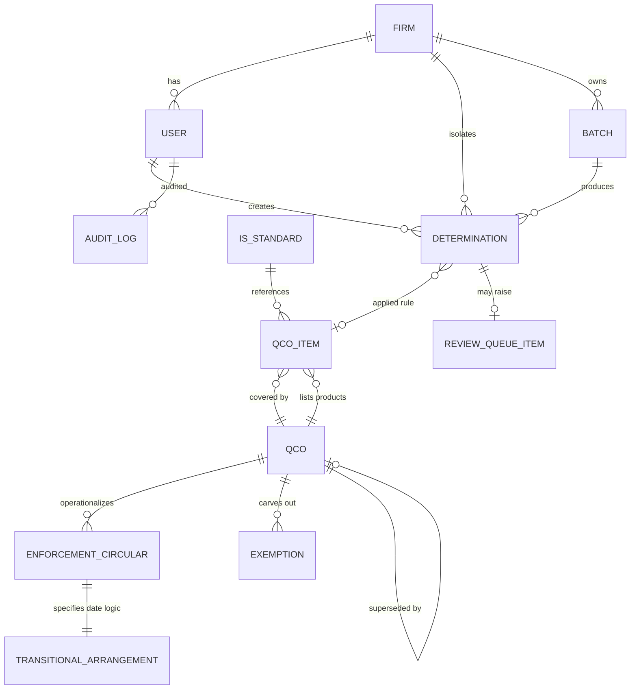
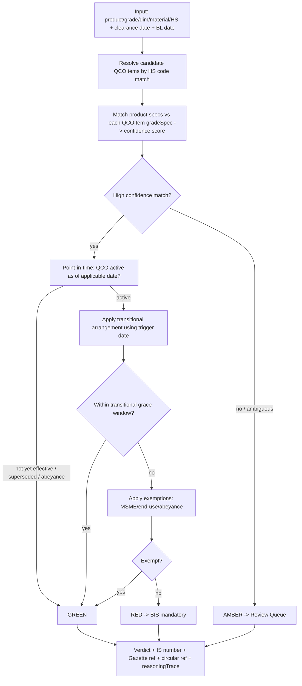

# QCO-Check V1 — Design

## 1. Architecture Overview

A single Next.js (App Router) application, end-to-end TypeScript, backed by PostgreSQL via Prisma. The heart is a **pure-TS rules-engine module** that takes a typed rule context and a typed input and returns a deterministic verdict + reasoning trace. Rules live in the DB (editable by admins, versioned, effective-dated). Every determination snapshots the rule versions active as of the applicable date so it stays reproducible after later amendments. Multi-tenancy isolates each firm's determinations; rules are a shared, admin-curated knowledge base. No LLM is ever in the determination path.

```
[Browser UI] <-> [Next.js App Router (RSC + API routes)]
                       |  - Auth.js (role-based: User/Admin)
                       |  - Tenant-scoping data-access layer
                       |  - Pure-TS rules engine module (deterministic)
                       |  - CSV parse + @react-pdf/renderer
                       v
                 [PostgreSQL via Prisma]  (Firms, Users, Rules, Determinations, Batches, Queue, Audit)
```

## 2. Data Model



### Entities

- **Firm** (id, name, createdAt). Tenant boundary.
- **User** (id, firmId nullable, email, role: USER | ADMIN, createdAt). ADMIN users are platform operators (firmId nullable); USER users belong to a firm.
- **QCO** (id, title, issuingAuthority, gazetteReference, notificationDate, status: DRAFT | PUBLISHED | SUPERSEDED | IN_ABEYANCE, supersededById nullable, version, sourceUrl, curatedBy, notes). Immutable once PUBLISHED; edits create new versions.
- **ISStandard** (id, isNumber e.g. "IS 2062", title, versionYear, notes).
- **QCOItem** (id, qcoId, productName, productDescription, gradeSpec JSONB {grade, dimensions, material}, isStandardIds[], hsCodes[]/ranges, notes). The atomic rule = "product matching these specs + HS codes requires BIS under [IS number] per [QCO]".
- **EnforcementCircular** (id, qcoId, circularReference, circularDate, effectiveDate, notes). The CBIC instrument that makes a date effective at customs.
- **TransitionalArrangement** (id, enforcementCircularId, triggerDateType: BILL_OF_LADING | CLEARANCE_DATE | BILL_OF_ENTRY | IMPORT_DATE, gracePeriodDays, conditionText, effectiveFrom, effectiveTo).
- **Exemption** (id, qcoId, type: MSME_PHASED | END_USE | NOT_DOMESTICALLY_AVAILABLE | ABEYANCE | DEFERRED, description, conditions JSONB, effectiveFrom, effectiveTo).
- **Determination** (id, firmId, userId, batchId nullable, input JSONB, qcoItemId nullable, qcoId nullable, enforcementCircularId nullable, verdict: GREEN | RED | AMBER, confidence, isNumber, gazetteReference, circularReference, transitionalStatus, reasoningTrace JSONB, status: COMPLETED | PENDING_REVIEW | RESOLVED, ruleVersionSnapshot JSONB, createdAt, resolvedAt, resolvedByAdminId nullable, promotionQcoItemId nullable). `ruleVersionSnapshot` guarantees point-in-time reproducibility.
- **Batch** (id, firmId, userId, fileName, totalRows, status: PROCESSING | COMPLETED | FAILED, createdAt).
- **ReviewQueueItem** (id, determinationId, status: PENDING | RESOLVED | PROMOTED, assignedAdminId nullable, resolutionVerdict: GREEN | RED nullable, promotedQcoItemId nullable, adminNotes, createdAt, resolvedAt).
- **AuditLog** (id, actorUserId, action, entity, entityId, before JSONB, after JSONB, at).

### Key modeling decisions
- **Mandate vs. enforcement separation**: a QCO holds the legal mandate (product table + IS numbers + Gazette ref); an EnforcementCircular holds the customs effective date + transitional arrangement. This matches reality (the 22 Dec 2020 notification was "made effective by circular5") and lets the engine cite the exact circular that triggers compliance.
- **HS code is a hint**: QCOs are written against IS standards + product descriptions, not HS codes. QCOItem stores hsCodes[]/ranges as a matching hint; the spec match (grade/dimensions/material within the IS scope) carries the decision, with confidence scoring.
- **Versioning + point-in-time**: QCO/QCOItem/EnforcementCircular carry version + effective-from fields; supersession is explicit. Determinations snapshot the active rule versions so they remain reproducible.
- **Global rules, tenant determinations**: rules are not tenant-scoped (shared compliance knowledge); determinations/batches are firm-scoped.

## 3. Rules Engine Design



### Engine contract (pure functions)
- `resolveCandidatesByHs(hsCode, ruleContext): QCOItem[]` — HS-based candidate set.
- `matchSpecs(input, qcoItem): { matched: boolean, confidence: number }` — spec matching with confidence.
- `isQcoActiveAsOf(qco, applicableDate): boolean` — point-in-time activity (effective date <= date; not superseded/in-abeyance as of date).
- `applicableTriggerDate(input, transitional): Date` — select BL date vs clearance date per `triggerDateType`.
- `inTransitionalWindow(triggerDate, transitional): boolean` — grace-window check.
- `evaluateExemptions(input, qco, applicableDate): Exemption | null`.
- `evaluate(input, ruleContext): Determination` — composes the above into a verdict + reasoningTrace.
- The engine takes a `RuleContext` (the rule versions, loaded server-side) and a typed `Input`; it has no DB/UI dependency, making it fully unit- and property-testable.

### Verdict logic
- **GREEN** — no active QCOItem as of the applicable date, OR the shipment falls in the transitional grace window, OR an exemption applies.
- **RED** — a QCOItem matches, its QCO is active as of the applicable date, and no transitional/exemption applies. Cite IS number + QCO Gazette ref + circular ref + transitional status.
- **AMBER** — ambiguous: low-confidence spec match, multiple candidate IS standards, or QCO/circular status unclear as of the date. Routes to the review queue.

### Date logic (the crux)
The engine looks up the governing QCO's EnforcementCircular → TransitionalArrangement.triggerDateType. If the trigger is BILL_OF_LADING, it evaluates using the user-supplied BL date; if CLEARANCE_DATE, the clearance date. V1 captures both dates and uses the one the QCO specifies. Boundary semantics (inclusive/exclusive at effective date and grace-window edges) must be explicitly defined and property-tested.

### Confidence scoring
- High: exact HS (8/10-digit) + exact grade + dimensions within IS scope.
- Low: HS 6-digit only + partial grade → Amber.
- Multiple candidate IS standards for one input → Amber.

## 4. Multi-tenancy & Auth
- Auth.js with a Prisma adapter; session/token carries `firmId` + `role`. `firmId` is derived from the session server-side, never trusted from the client.
- A service/data-access layer injects `firmId` where-clauses for USER scope (determinations/batches). ADMIN bypasses firm scoping for rules/queue and sees all firms' Amber cases. Rules are global.
- Roles: USER (firm-scoped, creates determinations), ADMIN (platform operator, curates rules, works the review queue, promotes cases to rules).

## 5. Tech Stack
- Next.js App Router + TypeScript + Tailwind CSS.
- Prisma + PostgreSQL.
- Auth.js (Prisma adapter), role-based (User/Admin). Clerk is an acceptable swap if managed auth is preferred.
- Pure-TS rules engine module (deterministic; no LLM in the determination path).
- CSV: server-side parse (papaparse) + per-row engine; results CSV download.
- PDF: server-side `@react-pdf/renderer` (TS, React components, references baked in; deterministic).
- Tests: Vitest (unit + property-based), fast-check (property-based testing), Playwright (E2E), ESLint/Prettier.
- Cross-platform npm scripts (Windows/PowerShell-friendly).

## 6. Testing Strategy
- **Unit tests (Vitest)**: engine functions, data-access tenant scoping, PDF content.
- **Property-based tests (Vitest + fast-check)**: engine invariants and reproducibility (see tasks Task 4 and Task 10 for required properties).
- **Integration tests**: API routes + Prisma (firm-scoped persistence).
- **E2E (Playwright)**: full journey — sign in → single check → PDF → batch → Amber case → admin resolve/promote → re-check.
- **Accessibility checks**: badges carry text + ARIA (not color alone); forms keyboard-navigable.

### Required property-based tests (fast-check) — invariants
Engine-level (Task 4):
- Determinism: `evaluate(input, ctx)` returns the same verdict + reasoning on repeated calls with identical input + rule context.
- No-active-QCO implies never RED: if no QCOItem is active as of the applicable date, verdict ∈ {GREEN, AMBER}, never RED.
- Confidence bounds: confidence ∈ [0,1] for all inputs.
- Transitional window monotonicity: if BL date falls within the grace window, the verdict is never RED (transitional exemption holds).
- Amber safety: low-confidence inputs never return RED.
- Spec/HS independence: verdict does not depend on fields absent from the matched QCOItem.
- Boundary correctness: dates exactly at the effective date / grace-window edges behave per defined inclusive/exclusive semantics.

Reproducibility & batch/CSV (Task 10):
- Reproducibility: re-running `evaluate` against a determination's snapshotted `ruleVersionSnapshot` yields the identical verdict.
- Batch row independence: a malformed/errored row does not alter other rows' verdicts.
- Parse robustness: CSV parsing preserves well-formed rows regardless of malformed rows elsewhere.
- Date-boundary consistency across single and batch paths: identical inputs produce identical verdicts through both the single-check and batch APIs.

## 7. Key Decisions & Rationale
- Pure-TS engine: guarantees zero hallucination and full testability; IS numbers and references come only from curated, versioned DB rows.
- Mandate/enforcement separation: the engine cites the exact CBIC circular that makes a date effective, matching how customs actually applies QCOs.
- Data-driven rules: editable via admin UI without deploys; required for the human-in-the-loop promote-to-rule loop.
- Point-in-time snapshots: legal defensibility — a determination made today remains reproducible after future amendments.
- Multi-tenant free model: firm isolation for determinations; shared rules; no billing in V1.
